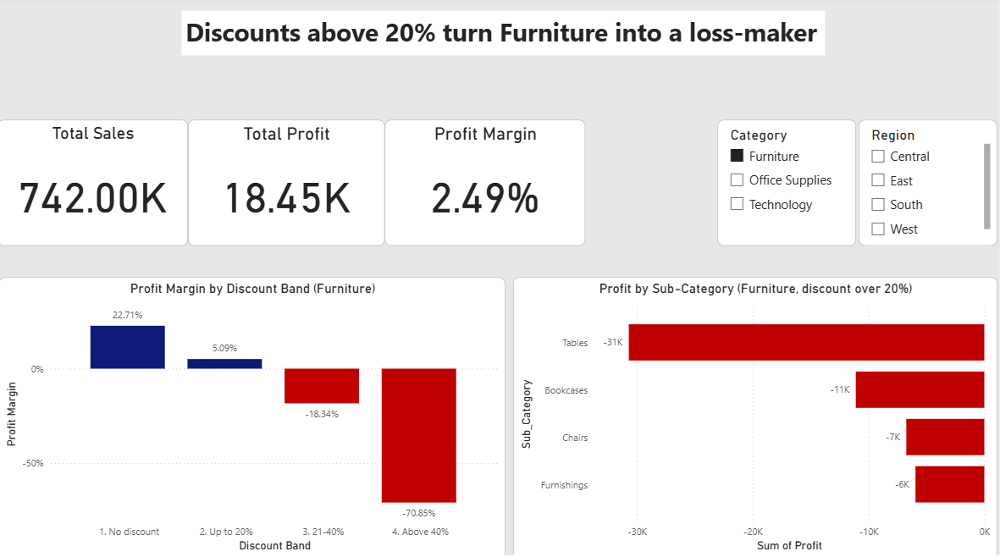

# Superstore Discount Analysis: When Discounts Turn Furniture into a Loss-Maker

## Problem
How do discounts affect profit in the Furniture category, and where should they be capped?
## Data
Superstore sales orders dataset (Furniture category: sales, profit, discount, sub-category, region).

## Method
- **Excel:** cleaned the data and grouped orders into discount bands.
- **SQL (SSMS):** calculated profit margin by discount band, then added segment, customer and region queries and verified the results.
- **Power BI:** built an interactive dashboard with Category and Region slicers.

## Findings
- Furniture earns a **22.7%** margin with no discount and **5.1%** with discounts up to 20%.
- Margin falls to **-18.3%** at 21-40% discount and **-70.9%** above 40%.
- The 542 order lines with discounts over 20% lost **$54,478** in total.
- Tables (-$30,698) and Bookcases (-$11,098) account for about **77%** of those losses.
- **Beyond Furniture:** The #1 customer by sales, Sean Miller, has a -7.9% profit margin. His loss comes from Machines orders discounted by 50% on average, which supports capping discounts at 20%.
- **By region:** Central has the lowest margin (7.9%) and the highest average discount (24.0%). West earns the most profit ($108,418) at a 14.9% margin with only a 10.9% average discount.
- **Best customers:** The most profitable customers, such as Tamara Chand ($8,981 profit, 47.1% margin), all have margins above 34%, while the top customer by sales, Sean Miller, loses money.

## Recommendation
Cap discounts at 20%, starting with Tables and Bookcases. Doing so could recover up to $54K in losses.

## Limitations
- Discounts and losses move together here, but this analysis can't prove discounts alone caused the losses (product mix and costs may also play a part).
- The savings figure is "up to" because some of those sales might not have happened without the discount.
- Results come from one dataset and one category.
